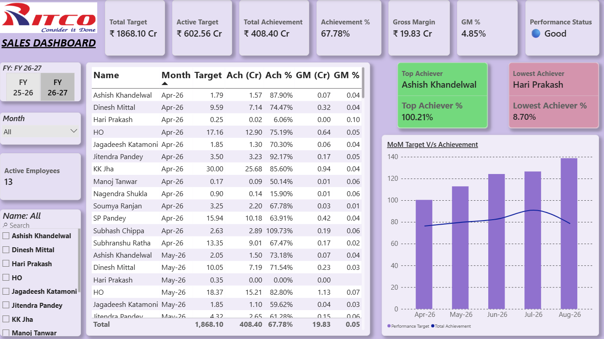

# Sales Performance & Target Planning Dashboard | Power BI

## Project Overview
An interactive Power BI dashboard developed to monitor sales performance against targets and evaluate salesperson performance, achievement, and gross margin.

## Tools & Technologies
- Power BI
- DAX
- Power Query
- Microsoft Excel

## Dashboard Preview

## Key Features
- Sales target versus achievement analysis
- Achievement percentage and gross margin monitoring
- Salesperson performance comparison
- KPI indicators to identify performance gaps
- Interactive filtering for performance analysis

## Key Learnings
Applied data modeling, DAX calculations, KPI tracking, and interactive visualization to support data-driven sales performance monitoring.
